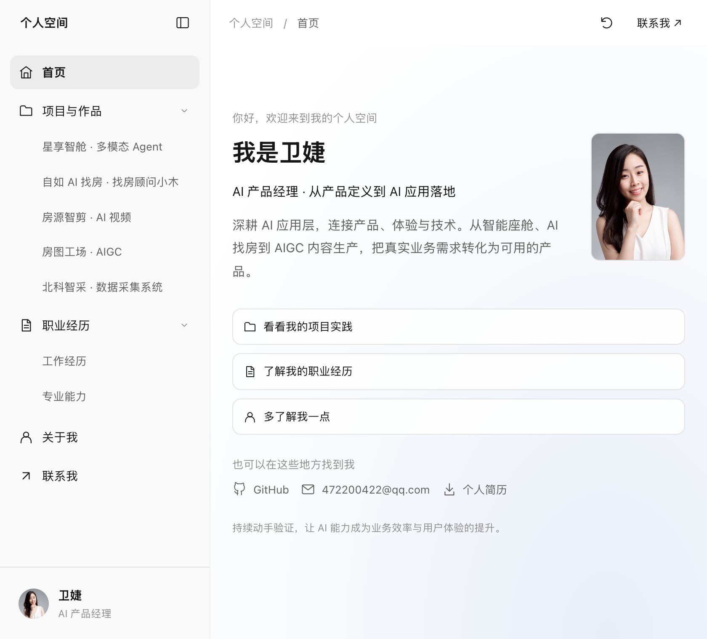

## Hi I'm Wendy 👋
Al Product Manager • Independent Developer
Building zero-friction, ready-to-use capability-layer tools & open-source Skills for Al Agents

## About me
- 🔭 Al Product Manager & Independent Developer, focused on AI Agent capability-layer tooling
- 🧰 Building for the agent ecosystem - Claude Code, Cursor, Codex, OpenClaw
- ✨ I believe in "zero config": great tools install with one command, and the agent just knows how to use them
- 💬 Exploring: Al Agent tooling• knowledge content automation • open-source Skills
- 🍃Open to feedback, feature requests, and contributions

<a href="https://weijie.hi.cn/" title="访问卫婕的个人网站">个人网站 ↗</a>

<!-- portfolio-preview:start -->

  

  <a href="https://weijie.hi.cn/"><strong>进入我的个人网站 ↗</strong></a>
   
  AI 产品经理 · 项目案例 · 工作经历 · 关于我

<!-- portfolio-preview:end -->
